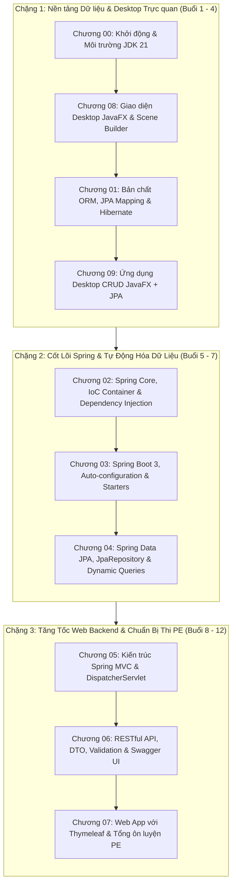

# 🎓 Lộ Trình Nghiên Cứu & Giảng Dạy HSF302 (Spring Boot 3 & JPA)

> [!abstract] **Thông Tin Khóa Học & Nền Tảng Kỹ Thuật**
> - **Tên môn học:** **HSF302** — JPA and Spring Framework
> - **Nền tảng công nghệ:** Java 21 LTS | Spring Boot 3.x | Hibernate 6 | Scene Builder 23 | Maven
> - **Tài liệu gốc:** 10 Chapter slide tại `D:\Obsidian_Save\Just_Something4Anti\Slides` (hoặc `E:\Mindy\HSF\Slides`)
> - **Cơ cấu đánh giá:** 
>   - 02 Progress Tests (10%)
>   - 02 Assignments (10%)
>   - 01 Practical Exam (PE - 25% — Điều kiện tiên quyết $\ge 4.0$)
>   - 01 Group Project (25%)
>   - Final Exam (FE - 30% — Điều kiện tiên quyết $\ge 4.0$)
> - **Quy chuẩn quản lý:** [[GEMINI|GEMINI.md]] | Kế hoạch chi tiết: [[implementation_plan|Kế Hoạch Triển Khai (To-Do Checklist)]]

---

## 🧭 Bản Đồ Kiến Thức 10 Chương & Chiến Lược Sư Phạm

Để sinh viên tiếp thu hiệu quả mà không bị "ngộp" bởi hệ sinh thái khổng lồ của Spring, lộ trình được chia thành **3 chặng tiến công**:

---

## 💡 Triết Lý Sư Phạm: "Dạy Bản Chất, Không Học Vẹt"

1. **Từ JDBC thuần sang Hibernate/JPA:**
   * *Nỗi đau của sinh viên:* Tự mở Connection, viết chuỗi SQL dài dằng dặc, duyệt `ResultSet` gán thủ công từng trường, đóng `Connection` dễ bị leak.
   * *Giải pháp JPA:* Dạy cách JPA coi bảng CSDL như Class Java (`@Entity`) và từng dòng dữ liệu là một Object.
2. **Từ `new` Object sang IoC Container / Dependency Injection:**
   * *Nỗi đau của sinh viên:* Class A tự khởi tạo Class B (`new Service()`), khi Class B đổi tham số thì Class A gãy hàng loạt.
   * *Giải pháp Spring:* Để Spring Container làm "ông mai bà mối", tự khởi tạo Bean và tiêm vào nơi cần thông qua Constructor Injection.
3. **Từ JPA thuần sang Spring Data JPA:**
   * *Nỗi đau:* Viết đi viết lại `entityManager.persist()`, `getTransaction().begin()`, `commit()`.
   * *Giải pháp Spring Data:* Chỉ cần `extends JpaRepository<Student, Long>` là có sẵn 20+ hàm CRUD mà không cần viết 1 dòng code triển khai nào.
4. **Từ HTML Form sang RESTful API Doanh Nghiệp:**
   * Định dạng dữ liệu chuẩn JSON, dùng đúng phương thức HTTP (GET, POST, PUT, DELETE), mã trạng thái HTTP chuẩn (200, 201, 400, 404, 500).

---

## 📅 Lịch Trình Giảng Dạy Dự Kiến (12 Buổi Học)

| Buổi | Tên Chuyên Đề | Trọng Tâm Kiến Thức | Slide Tham Chiếu | Mã Code / Lab Mẫu | Trạng Thái |
| :---: | :--- | :--- | :---: | :---: | :---: |
| **01** | Setup & JavaFX UI Cơ Bản | Cài đặt JDK 21, IntelliJ, Scene Builder 23. Stage, Scene, FXML, Controller, Event Handling. | Chương 00, 08 | `Starter-01-JavaFX` | ⬜ Chờ duyệt |
| **02** | Xây dựng UI Quản Lý | Bố cục Layout (BorderPane, VBox, HBox), TableView, TextField, ComboBox, CSS styling. | Chương 08 | `Starter-01-JavaFX` | ⬜ Chờ duyệt |
| **03** | Bản Chất JPA & ORM | Cấu hình `persistence.xml`, Entity Lifecycle, Mapping `@Entity`, `@Id`, `@Column`, Mối quan hệ 1-N. | Chương 01 | `Lab-01-JPA` | ⬜ Chờ duyệt |
| **04** | Ghép Nối JavaFX + JPA | Xây dựng hoàn chỉnh CRUD Desktop kết nối Database SQLite / MySQL với Hibernate. | Chương 09 | `Lab-01-CRUD-Desktop` | ⬜ Chờ duyệt |
| **05** | Cốt Lõi Spring (IoC & DI) | Spring Bean, ApplicationContext, `@Component`, `@Autowired`, Constructor Injection, Bean Scopes. | Chương 02 | `Lab-02-SpringCore` | ⬜ Chờ duyệt |
| **06** | Spring Boot 3 & Starters | Spring Initializr, cấu trúc project Boot 3, cơ chế Auto-configuration, `application.properties`. | Chương 03 | `Starter-02-Boot` | ⬜ Chờ duyệt |
| **07** | Spring Data JPA | Khởi tạo `JpaRepository`, Query Methods tự sinh (`findByNameContaining`), `@Query` JPQL. | Chương 04 | `Starter-02-Boot` | ⬜ Chờ duyệt |
| **08** | Kiến Trúc Spring MVC | Cơ chế `DispatcherServlet`, Model, View, Controller, cách thức xử lý luồng Web request. | Chương 05 | Demo MVC | ⬜ Chờ duyệt |
| **09** | Xây Dựng RESTful API | `@RestController`, `@GetMapping`, `@PostMapping`, `@PutMapping`, `@DeleteMapping`, `ResponseEntity`. | Chương 06 | `Starter-02-Boot` | ⬜ Chờ duyệt |
| **10** | DTO & Exception Handling | Tách DTO với Entity, Validation dữ liệu (`@Valid`), bắt lỗi toàn cục bằng `@RestControllerAdvice`. | Chương 06 | `Starter-02-Boot` | ⬜ Chờ duyệt |
| **11** | Swagger & Test API | Tích hợp OpenAPI Swagger UI, kịch bản test bằng Postman, giải quyết bài toán phân trang (Pageable). | Chương 06 | `Starter-02-Boot` | ⬜ Chờ duyệt |
| **12** | Tổng Ôn Luyện Thi PE | Giải thử 01 đề thi PE hoàn chỉnh giới hạn 90 phút, công thức "chống liệt" và tối ưu điểm số. | Chương 07 | `PE-Mock-01` | ⬜ Chờ duyệt |

---

## 🗂️ Cấu Trúc Tài Liệu Trong Vault

* 📂 **`01. Giao Trinh & 10 Chuong Slide/`**: Tóm tắt kiến thức cốt lõi, câu hỏi phỏng vấn, bẫy thường gặp (gotchas) của 10 chương.
* 📂 **`02. Bo Code Mau & Starter Kits/`**: Hướng dẫn kiến trúc, file `pom.xml`, cấu hình chuẩn cho các Starter Kits.
  * 🌟 **Dự án thực hành mẫu:** [[Huong Dan Chay & Mo IntelliJ Project Demo JPA|Hướng Dẫn Mở & Chạy Dự Án Demo JPA (User - Profile - Order) Trên IntelliJ IDEA]] (`E:\Mindy\HSF\Code_Demo\spring-boot-jpa-demo`).
* 📂 **`03. Bai Lab & Thuc Hanh/`**: Các bài lab từng bước có hình ảnh minh họa cho sinh viên tự luyện tập.
  * 🌟 **Bài Lab JPA Cốt Lõi:** [[Giai Thich Chi Tiet Bai Tap Mau JPA (User-Profile-Order)|Giải Thích Chi Tiết Bài Tập Mẫu JPA (User - Profile - Order) từ Cấp 1 đến Cấp 3]] (Mổ xẻ under-the-hood, Cascade, Dirty Checking, N+1, orphanRemoval).
  * 🌟 **Đề Bài RESTful API Doanh Nghiệp:** [[Huong Dan Xay Dung RESTful API Product Catalog|Hướng Dẫn Xây Dựng RESTful API Quản Lý Danh Mục & Sản Phẩm (Product Catalog API)]] (Database First, DTO, Validation, Swagger UI).
* 📂 **`04. On Thi & Danh Gia/`**: Hướng dẫn đề cương 2 bài kiểm tra tiến độ (PT), bài tập lớn (AS) và bộ đề PE thực chiến.
  * 🌟 [[Chien Luoc On Thi Practical Exam PE|Chiến Lược Ôn Thi Practical Exam (PE)]]
  * 🌟 [[De Thi Mau PE - AMG Artifact Management System|Đề Thi Mẫu PE: AMG - Artifact Management System (Kèm Script DB + Seed Data)]]
  * 🌟 [[De Thi PE1 SU26 - SDM Smart Device Management|Giải Full Đề Thi PE1 SU26: SDM - Smart Device Management (Chuẩn 10/10)]]
  * 🌟 [[Tong Hop Hoi Dap Chuyen Sau & Meo Thi PE HSF302|Tổng Hợp Hỏi Đáp Chuyên Sâu & Mẹo Thi Thực Chiến PE HSF302]]
* 📄 **`implementation_plan.md`**: Bảng checklist công việc cần hoàn thành giữa AI và Giảng viên.

---
*Điều hướng nhanh: [[implementation_plan|Kế Hoạch Triển Khai]] | [[GEMINI|Bộ Quy Chuẩn GEMINI]]*
