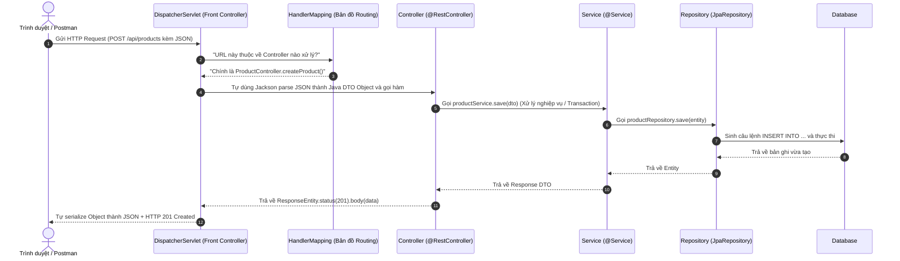
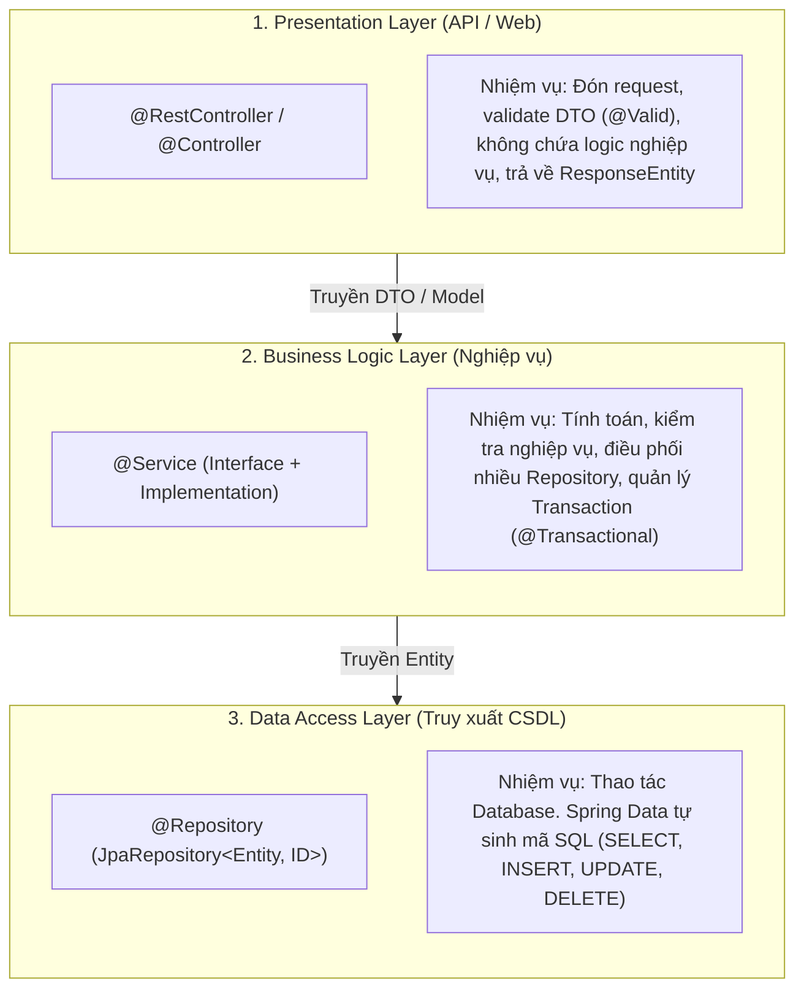

# 🧠 Giải Thích Bản Chất Spring Boot 3 Dưới Góc Nhìn .NET & Java Web MVC

> [!abstract] **Mục tiêu tài liệu:**
> Tài liệu này được thiết kế dành riêng cho bạn — người **đã hiểu mô hình 3-layer, từng làm việc với .NET và có nền tảng Java Web MVC (Servlet/JSP)**. 
> Mục tiêu là **chuyển hóa tư duy (Mental Model)** từ .NET và Java Servlet sang Spring Boot 3 một cách tự nhiên nhất, hiểu rõ "dưới gầm máy nó chạy cái gì", bám sát nội dung các Chapter slide HSF302.

---

## 🗺️ 1. Bảng Đối Chiếu Tư Duy: .NET Core vs Spring Boot 3

Nếu bạn đã quen với cách .NET vận hành, Spring Boot về bản chất giải quyết **chính xác cùng một bài toán**, chỉ khác cú pháp và triết lý cấu hình:

| Thành Phần Kiến Trúc | Trong .NET (ASP.NET Core) | Trong Spring Boot 3 (Java) | Bản Chất Bên Dưới (Under the hood) |
| :--- | :--- | :--- | :--- |
| **Điểm khởi chạy (Entry Point)** | `Program.cs` (`Main()`) | `Application.java` (`main()`) | Khởi tạo runtime, nạp cấu hình và kích hoạt DI Container. |
| **Web Server tích hợp** | Kestrel Server | Embedded Tomcat Server | Tích hợp sẵn server chạy trên cổng `8080`, không cần cài Tomcat/IIS rời. |
| **Bộ chứa DI (IoC Container)** | `IServiceCollection` / `builder.Services` | `ApplicationContext` / `BeanFactory` | Nơi lưu giữ và quản lý vòng đời toàn bộ các Object dùng chung (Beans). |
| **Đăng ký Dependency** | `builder.Services.AddScoped<I..., ...>()` | `@Component`, `@Service`, `@Repository` | .NET đăng ký bằng code ở `Program.cs`; Spring dùng **Component Scanning** (quét thư mục tự nhận diện). |
| **Tiêm Dependency (DI)** | Constructor Injection | Constructor Injection (Khuyên dùng) | Đều đưa Interface/Class vào Constructor để framework tự truyền instance. |
| **Controller nhận Request** | `[ApiController]` + `[Route("api/[controller]")]` | `@RestController` + `@RequestMapping("/api/...")` | Đứng đón HTTP request, chuyển đổi JSON $\leftrightarrow$ Object. |
| **Phương thức HTTP** | `[HttpGet]`, `[HttpPost]`, `[HttpPut]`, `[HttpDelete]` | `@GetMapping`, `@PostMapping`, `@PutMapping`, `@DeleteMapping` | Định tuyến (Routing) URL và HTTP method tương ứng. |
| **Dữ liệu trả về** | `ActionResult<T>`, `IActionResult` | `ResponseEntity<T>` | Đóng gói HTTP Status Code (200, 201, 404...) + Headers + Body JSON. |
| **Tầng Dữ Liệu (ORM)** | Entity Framework Core (`DbContext`, `DbSet<T>`) | Hibernate 6 / Jakarta Persistence (`EntityManager`) | Ánh xạ bảng CSDL thành Object Java / C#. |
| **Tầng Repository** | Tự viết `GenericRepository<T>` hoặc gọi `_context.Set<T>()` | Kế thừa `JpaRepository<T, ID>` | Spring Data **tự sinh code** truy vấn CRUD mà không cần viết 1 dòng implementation nào. |
| **Cấu hình môi trường** | `appsettings.json` | `application.properties` (hoặc `.yml`) | Chứa chuỗi kết nối Database, cổng server, logging... |

---

## ⚙️ 2. "Dưới Gầm Máy": Luồng Chạy Của 1 Request (Từ Java Web Cũ $\rightarrow$ Spring Boot)

### 📌 Nhìn lại Java Web cũ (Servlet/JSP - PRJ301)
* Trong Java Web truyền thống, bạn tạo một class kế thừa `HttpServlet`, ghi đè `doGet(HttpServletRequest req, HttpServletResponse resp)`:
  1. Tự parse tham số: `String id = req.getParameter("id");`
  2. Tự ép kiểu: `int studentId = Integer.parseInt(id);`
  3. Tự gọi DAO lấy dữ liệu: `Student s = studentDAO.getById(studentId);`
  4. Tự convert sang JSON (bằng Gson) hoặc set attribute để forward sang JSP.
* 👉 **Nhược điểm:** Viết quá nhiều code lặp đi lặp lại (boilerplate code), dễ dính lỗi `NullPointerException` và quản lý vòng đời DAO rất cực.

### 🚀 Spring Boot làm gì thay bạn? (Mô hình Front Controller)
Spring Boot sử dụng mô hình kinh điển **Front Controller Pattern** xoay quanh một Servlet duy nhất gọi là **`DispatcherServlet`** (được trình bày ở **Chương 05**):



> [!tip] **Điểm cốt lõi:**
> Bạn không cần viết Servlet nữa. `DispatcherServlet` đứng ở cửa ngõ, làm mọi việc nặng nhọc: đọc JSON, parse kiểu dữ liệu, validate dữ liệu, rồi chuyển tiếp vào method trong `@RestController` của bạn.

---

## 🧩 3. Mô Hình 3-Layer Trong Spring Boot Được Triển Khai Thế Nào?

Bạn đã nắm mô hình 3-layer: **API/UI $\rightarrow$ Service $\rightarrow$ Repository**. Trong Spring Boot, nó được hiện thực hóa qua các **Spring Beans & Annotations**:



### 1. Tầng Repository (Spring Data JPA — Chương 04)
Trong .NET EF Core, bạn viết:
```csharp
var product = await _context.Products.FirstOrDefaultAsync(p => p.Id == id);
```
Trong Spring Boot, bạn chỉ cần khai báo một **Interface rỗng**:
```java
public interface ProductRepository extends JpaRepository<Product, Long> {
    // Có sẵn: save(), findById(), findAll(), deleteById(), count()...
    
    // Nếu muốn tìm theo tên, chỉ cần viết đúng tên hàm, Spring TỰ SINH SQL:
    List<Product> findByNameContaining(String keyword);
}
```

### 2. Tầng Service (Xử lý nghiệp vụ — Chương 02)
```java
@Service
public class ProductServiceImpl implements ProductService {
    private final ProductRepository productRepository;

    // Constructor Injection (Giống hệt .NET Core)
    public ProductServiceImpl(ProductRepository productRepository) {
        this.productRepository = productRepository;
    }

    @Override
    @Transactional // Quản lý Transaction tự động (Rollback nếu có Exception)
    public ProductResponse createProduct(ProductRequest request) {
        // 1. Kiểm tra nghiệp vụ (VD: tên đã tồn tại chưa)
        // 2. Chuyển DTO thành Entity
        // 3. Lưu vào Database qua Repository
        Product entity = new Product(request.getName(), request.getPrice());
        Product saved = productRepository.save(entity);
        return new ProductResponse(saved.getId(), saved.getName(), saved.getPrice());
    }
}
```

### 3. Tầng Controller (REST Endpoint — Chương 06)
Trong .NET bạn dùng `[ApiController]`, trong Spring Boot là `@RestController`:
```java
@RestController
@RequestMapping("/api/v1/products")
public class ProductController {
    private final ProductService productService;

    public ProductController(ProductService productService) {
        this.productService = productService;
    }

    @PostMapping
    public ResponseEntity<ProductResponse> create(@Valid @RequestBody ProductRequest request) {
        ProductResponse response = productService.createProduct(request);
        return ResponseEntity.status(HttpStatus.CREATED).body(response); // HTTP 201
    }

    @GetMapping("/{id}")
    public ResponseEntity<ProductResponse> getById(@PathVariable Long id) {
        return ResponseEntity.ok(productService.getById(id)); // HTTP 200
    }
}
```

---

## 🎯 4. Bản Chất IoC & Dependency Injection: Tại Sao Không Dùng `new`?

* Trong Java cổ điển:
  ```java
  public class ProductController {
      private ProductService service = new ProductServiceImpl(); // TIGHT COUPLING!
  }
  ```
  Nếu `ProductServiceImpl` cần thêm `MailService` vào hàm tạo $\rightarrow$ Controller bị lỗi biên dịch.
* Trong Spring Boot (Chương 02):
  Spring đóng vai trò một **nhà máy tạo đối tượng (Container)**. Khi ứng dụng bật lên:
  1. Spring quét qua toàn bộ project (Component Scan).
  2. Thấy class nào có `@Service`, `@Repository`, `@RestController`, nó sẽ tự động tạo **đúng 1 instance (Singleton)** lưu vào bộ nhớ RAM.
  3. Thấy `ProductController` yêu cầu `ProductService` trong Constructor $\rightarrow$ Spring tự tìm instance đã tạo và "tiêm" vào (Inject). Bạn hoàn toàn không cần gõ chữ `new`.

---

## 🗺️ 5. Sự Khác Biệt Giữa JPA thuần và Spring Boot Data JPA (Chương 01 vs Chương 04)

Slide môn HSF chia làm 2 giai đoạn về CSDL:
1. **Giai đoạn đầu (Chương 01 - JPA/Hibernate thuần):**
   * Sinh viên phải tự quản lý `EntityManagerFactory`, mở `EntityManager`, tự mở giao dịch `transaction.begin()`, gọi `em.persist(object)`, rồi `transaction.commit()`.
   * *Mục đích giảng dạy:* Để sinh viên hiểu **Entity Lifecycle** (Transient, Managed, Detached) và bản chất Hibernate sinh SQL như thế nào.
2. **Giai đoạn sau (Chương 04 - Spring Data JPA):**
   * Đưa vào `JpaRepository`. Toàn bộ code mở/đóng transaction và `EntityManager` được Spring tự động hóa 100%.

---
*Điều hướng: [[00. Lộ Trình Nghiên Cứu & Giảng Dạy HSF302|Về Trang Chủ Lộ Trình]] | [[implementation_plan|Kế Hoạch Triển Khai]]*
