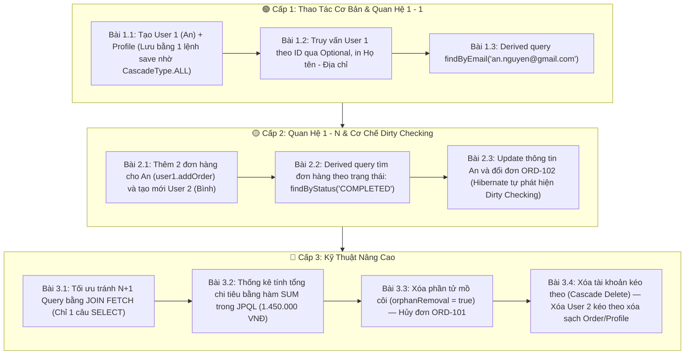

# 💻 Hướng Dẫn Mở & Chạy Dự Án Demo JPA (User - Profile - Order) Trên IntelliJ IDEA

> [!abstract] **Thông tin dự án mã nguồn:**
> - **Tên dự án:** `spring-boot-jpa-demo`
> - **Đường dẫn thư mục mã nguồn:** [`E:\Mindy\HSF\Code_Demo\spring-boot-jpa-demo`](file:///E:/Mindy/HSF/Code_Demo/spring-boot-jpa-demo)
> - **Nền tảng kỹ thuật:** Java 21 LTS | Spring Boot 3.3.4 | Spring Data JPA | H2 In-Memory Database | Maven
> - **Quản lý Git:** Đã khởi tạo Git cục bộ tại thư mục gốc của project và commit toàn bộ code.

---

## 🧭 1. Cách Mở Dự Án Trong IntelliJ IDEA

1. **Mở IntelliJ IDEA:**
   * Chọn menu **File** $\rightarrow$ **Open...**
   * Dán hoặc duyệt đến đường dẫn: `E:\Mindy\HSF\Code_Demo\spring-boot-jpa-demo`
   * Chọn tệp `pom.xml` hoặc thư mục dự án và nhấn **OK** $\rightarrow$ Chọn **Open as Project**.
2. **Kiểm tra JDK:**
   * Nhấn `Ctrl + Alt + Shift + S` (Project Structure).
   * Tại tab **Project**, đảm bảo mục **SDK** chọn **JDK 21** (hoặc JetBrains Runtime 21/25 có sẵn).
3. **Chạy ứng dụng:**
   * Mở cây thư mục: `src/main/java/com/hsf/jpademo/JpaDemoApplication.java`.
   * Nhấn chuột phải $\rightarrow$ Chọn **Run 'JpaDemoApplication'** (hoặc bấm nút tam giác xanh `▶️` ở góc trên bên phải).

---

## 📺 2. Kết Quả Chạy Tự Động (CommandLineRunner)

Ứng dụng được tích hợp sẵn lớp `DataInitializerAndDemoRunner`. Khi bấm Run, Spring Boot khởi động và tự động chạy lần lượt 10 bài tập qua 3 cấp độ:

---

## 🌐 3. Cách Mở H2 Console Để Xem CSDL Trực Quan

Trong khi ứng dụng đang chạy:
1. Mở trình duyệt web truy cập: [http://localhost:8080/h2-console](http://localhost:8080/h2-console)
2. Điền thông tin kết nối (như trong `application.properties`):
   * **Driver Class:** `org.h2.Driver`
   * **JDBC URL:** `jdbc:h2:mem:hsf_db`
   * **User Name:** `sa`
   * **Password:** *(để trống)*
3. Bấm **Connect**: Bạn sẽ thấy danh sách 3 bảng `USERS`, `USER_PROFILES`, `ORDERS` bên trái. Có thể gõ lệnh `SELECT * FROM USERS;` để tra cứu trực tiếp.

---

## 📦 4. Chi Tiết Các File Trong Mã Nguồn

| Đường Dẫn Tệp | Vai Trò & Điểm Nhấn Sư Phạm |
| :--- | :--- |
| `src/main/java/com/hsf/jpademo/entity/User.java` | Thực thể trung tâm. Sử dụng `mappedBy = "user"`, `cascade = CascadeType.ALL`, `orphanRemoval = true`. Chứa 3 helper methods quan trọng: `setProfile`, `addOrder`, `removeOrder` để đồng bộ 2 chiều trong bộ nhớ RAM. |
| `src/main/java/com/hsf/jpademo/entity/UserProfile.java` | Owning side của quan hệ 1 - 1. Giữ khóa ngoại `@JoinColumn(name = "user_id", unique = true)`. |
| `src/main/java/com/hsf/jpademo/entity/Order.java` | Owning side của quan hệ Many - 1. Giữ khóa ngoại `@JoinColumn(name = "user_id", nullable = false)`. Tiền tệ dùng `BigDecimal`. |
| `src/main/java/com/hsf/jpademo/repository/UserRepository.java` | Chứa `findByEmail` (Derived query) và `findUserFullDetailsById` (Dùng `LEFT JOIN FETCH` diệt tận gốc lỗi N+1). |
| `src/main/java/com/hsf/jpademo/repository/OrderRepository.java` | Chứa `findByStatus` và `calculateTotalSpentByUserAndStatus` (Hàm tổng hợp `SUM` trong JPQL). |
| `src/main/java/com/hsf/jpademo/service/StudentLabService.java` | Triển khai logic nghiệp vụ 10 bài tập với `@Transactional`. |
| `src/main/java/com/hsf/jpademo/runner/DataInitializerAndDemoRunner.java` | Tự động chạy toàn bộ kịch bản và in banner kết quả ra console. |

---
*Điều hướng nhanh: [[00. Lộ Trình Nghiên Cứu & Giảng Dạy HSF302|Trang Chủ Lộ Trình]] | [[Giai Thich Chi Tiet Bai Tap Mau JPA (User-Profile-Order)|Lý Thuyết Chi Tiết Bài Tập JPA]]*
