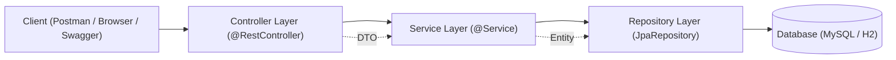

# 🛠️ Kiến Trúc 2 Bộ Starter Kits Thực Chiến Môn HSF302

> [!abstract] **Mục tiêu của bộ Starter Kits**
> Giúp sinh viên và giảng viên có ngay khung dự án chuẩn kiến trúc (clean architecture), cài đặt sẵn các thư viện cần thiết, loại bỏ rào cản cấu hình ban đầu để tập trung 100% vào tư duy lập trình và bản chất của framework.

---

## 🖥️ Bộ 1: `Starter-01-JavaFX-JPA` (Ứng Dụng Quản Lý Desktop)

### 1. Kiến Trúc & Công Nghệ
* **Java:** JDK 21 LTS
* **Giao diện:** JavaFX 21 (FXML + Scene Builder 23)
* **ORM:** Hibernate 6 / Jakarta Persistence (JPA 3.1)
* **Database:** SQLite hoặc H2 (chạy cục bộ không cần cài SQL Server phức tạp, có thể chuyển sang SQL Server/MySQL bằng đổi chuỗi kết nối)
* **Build Tool:** Maven

### 2. Cấu Trúc Thư Mục Chuẩn
```text
Starter-01-JavaFX-JPA/
├── pom.xml
├── README.md
└── src/
    └── main/
        ├── java/
        │   └── com/hsf/javafx/
        │       ├── App.java                 # Kế thừa javafx.application.Application, load MainView.fxml
        │       ├── controller/
        │       │   └── StudentController.java # Gắn @FXML, xử lý sự kiện nút bấm, tương tác TableView
        │       ├── entity/
        │       │   └── Student.java          # Entity JPA: @Entity, @Id, @Column...
        │       ├── repository/
        │       │   └── StudentRepository.java # Quản lý EntityManager, các hàm CRUD
        │       └── util/
        │           └── JpaUtil.java          # Tạo Singleton EntityManagerFactory
        └── resources/
            ├── META-INF/
            │   └── persistence.xml           # Cấu hình Hibernate dialect, database connection
            ├── view/
            │   └── MainView.fxml             # File giao diện kéo thả từ Scene Builder
            └── css/
                └── style.css                 # Trang trí giao diện hiện đại
```

---

## 🌐 Bộ 2: `Starter-02-SpringBoot3-REST` (Backend RESTful API Doanh Nghiệp)

### 1. Kiến Trúc & Công Nghệ
* **Framework:** Spring Boot 3.3.x (Spring Framework 6.x)
* **Java:** JDK 21 LTS
* **Dependencies:**
  * `spring-boot-starter-web`: Xây dựng RESTful web services và Tomcat embedded.
  * `spring-boot-starter-data-jpa`: Tự động hóa tầng Repository với Spring Data JPA.
  * `spring-boot-starter-validation`: Validation dữ liệu đầu vào (@NotNull, @Size, @Email).
  * `springdoc-openapi-starter-webmvc-ui`: Tự động sinh tài liệu Swagger UI tại `/swagger-ui.html`.
  * `h2` (In-memory test) & `mysql-connector-j` (hoặc `mssql-jdbc`).
* **Lombok** (tùy chọn) để giảm bớt code Getter/Setter.

### 2. Mô Hình Phân Tầng Chuẩn (Layered Architecture)


### 3. Cấu Trúc Thư Mục Chuẩn
```text
Starter-02-SpringBoot3-REST/
├── pom.xml
├── README.md
└── src/
    └── main/
        ├── java/
        │   └── com/hsf/springboot/
        │       ├── Application.java              # @SpringBootApplication (Hàm main)
        │       ├── controller/
        │       │   └── ProductController.java    # @RestController, expose REST endpoints
        │       ├── service/
        │       │   ├── ProductService.java       # Interface nghiệp vụ
        │       │   └── impl/
        │       │       └── ProductServiceImpl.java # Triển khai nghiệp vụ, xử lý logic
        │       ├── repository/
        │       │   └── ProductRepository.java    # extends JpaRepository<Product, Long>
        │       ├── entity/
        │       │   └── Product.java              # JPA Entity kết nối bảng CSDL
        │       ├── dto/
        │       │   ├── ProductRequestDto.java    # Dữ liệu gửi lên kèm @Valid
        │       │   └── ProductResponseDto.java   # Dữ liệu trả về cho client
        │       └── exception/
        │           ├── ResourceNotFoundException.java # Exception tùy biến khi không tìm thấy record
        │           ├── ErrorResponse.java        # Khuôn mẫu JSON trả về khi có lỗi
        │           └── GlobalExceptionHandler.java # @RestControllerAdvice bắt toàn bộ Exception
        └── resources/
            └── application.properties            # Cấu hình DataSource, JPA DDL-Auto, Port, Swagger
```

---
*Điều hướng: [[00. Lộ Trình Nghiên Cứu & Giảng Dạy HSF302|Về Trang Chủ Lộ Trình]] | [[implementation_plan|Kế Hoạch Triển Khai]]*
