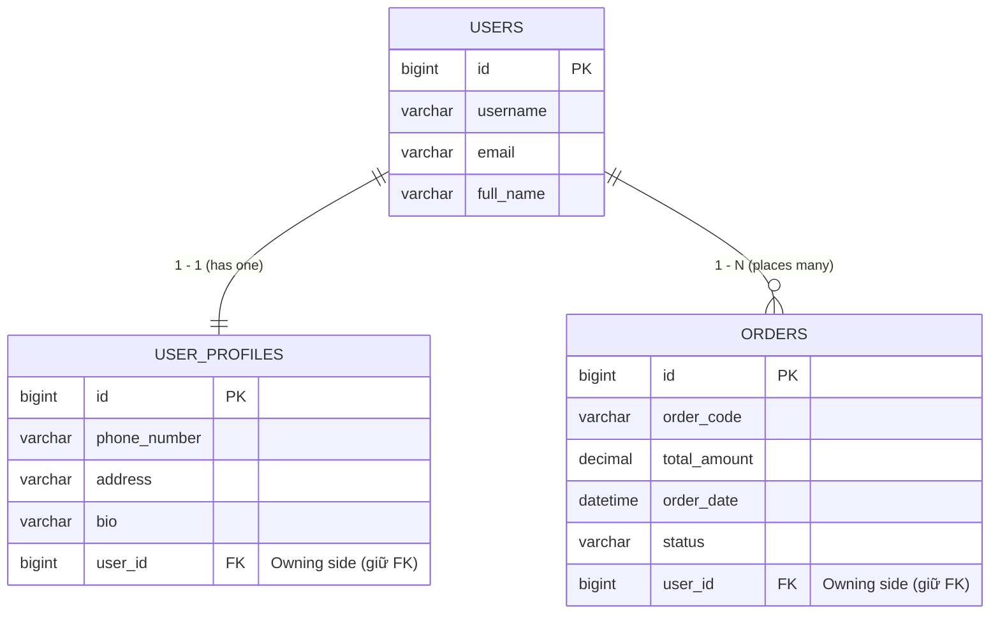

# 🔍 Giải Mã Toàn Diện Bài Tập Thực Hành JPA (User - Profile - Order)
## Từ Cấp 1 Đến Cấp 3: Bản Chất Kỹ Thuật, Cơ Chế Dưới Nền & Đối Chiếu .NET

> [!abstract] **Mục tiêu tài liệu:**
> Tài liệu này mổ xẻ chi tiết từng dòng code và cơ chế "dưới gầm máy" (under the hood) của bộ bài tập 3 cấp độ mà sinh viên của bạn đang làm. 
> Chúng ta sẽ đối chiếu trực tiếp với **CSDL quan hệ**, **Entity Framework Core (.NET)** và **Java Web MVC** để bạn nắm chắc 100% bản chất trước khi dạy sinh viên.

---

## 🏗️ PHẦN 1: BẢN ĐỒ DỮ LIỆU & THIẾT KẾ THỰC THỂ (ENTITIES)

Bộ bài tập xoay quanh 3 thực thể kinh điển đại diện cho 2 loại quan hệ cốt lõi trong CSDL:
1. **Quan hệ 1 - 1 (One-to-One):** `User` $\leftrightarrow$ `UserProfile` (1 người có 1 hồ sơ).
2. **Quan hệ 1 - N (One-to-Many / Many-to-One):** `User` $\leftrightarrow$ `Order` (1 người có nhiều đơn hàng).



### 🔑 Khái niệm "Chí Mạng": Owning Side vs Inverse Side (Ai giữ khóa ngoại FK?)
* Trong CSDL quan hệ: Bảng nào có cột **Khóa ngoại (Foreign Key - `user_id`)** thì bảng đó là bên nắm giữ quan hệ.
* Trong JPA:
  * **Owning Side (Bên sở hữu):** Là entity giữ `@JoinColumn(name = "user_id")`. Mọi thay đổi trên field này sẽ trực tiếp sinh lệnh SQL `INSERT/UPDATE` cột FK dưới DB. Ở đây, `UserProfile` và `Order` là Owning Side.
  * **Inverse Side (Bên đối ứng / Bị sở hữu):** Là entity dùng `mappedBy = "user"`. Nó chỉ đóng vai trò "soi chiếu" dữ liệu (read-only perspective), **Hibernate KHÔNG nhìn vào bên này để sinh câu lệnh gán FK**.
  * 👉 *Tương đương trong .NET EF Core:* Giống việc bạn cấu hình Fluent API: `builder.HasOne(u => u.Profile).WithOne(p => p.User).HasForeignKey<UserProfile>(p => p.UserId);`.

---

## 🎯 PHẦN 2: MỔ XẺ CHI TIẾT CẤP ĐỘ 1 (CƠ BẢN)

### 1.1. Bài 1.1: Thêm mới 1 - 1 với `CascadeType.ALL`
* **Mục tiêu:** Chỉ gọi `userRepository.save(user1)`, hệ thống tự lưu cả `users` và `user_profiles`.
* **Vấn đề nếu KHÔNG có Cascade:**
  * Cả `user1` và `profile1` lúc mới dùng toán tử `new` đều ở trạng thái **Transient** (đối tượng Java thuần trong RAM, CSDL chưa hề biết tới).
  * Nếu không có Cascade, Hibernate sẽ ném lỗi: `TransientPropertyValueException: object references an unsaved transient instance`. Bạn sẽ buộc phải lưu Profile trước (`profileRepo.save(profile)`), lấy ID rồi mới lưu User.
* **`CascadeType.ALL` (hoặc `PERSIST`) hoạt động thế nào?**
  * Khi bạn gọi `userRepository.save(user1)`, Hibernate thấy quan hệ `@OneToOne(cascade = CascadeType.ALL)`.
  * Nó tự động "lan truyền" (cascade) trạng thái lưu sang `profile1`.
  * **Chuỗi SQL sinh ra dưới nền:**
    ```sql
    -- Bước 1: Lưu User để lấy ID tự tăng (vd id = 1)
    INSERT INTO users (username, email, full_name) VALUES ('an.nguyen', 'an.nguyen@gmail.com', 'Nguyễn Văn An');
    
    -- Bước 2: Lưu Profile và tự động điền user_id = 1 vào FK
    INSERT INTO user_profiles (phone_number, address, bio, user_id) VALUES ('0901234567', 'Hà Nội', 'Lập trình viên', 1);
    ```

---

### 1.2. Bài 1.2: Truy vấn cơ bản theo ID & Đối tượng `Optional<T>`
* **Cú pháp:** `userRepository.findById(1L)` trả về `Optional<User>`.
* **Tại sao Spring Boot dùng `Optional` thay vì trả về `User` trực tiếp?**
  * Nếu truyền vào ID không tồn tại (vd: ID = 999), hàm trả về `Optional.empty()` thay vì `null`.
  * Điều này ép lập trình viên phải kiểm tra trước khi dùng (tránh lỗi kinh điển `NullPointerException` từng ám ảnh thời Java Web cũ).
  * Cách dùng chuẩn:
    ```java
    User user = userRepository.findById(1L)
        .orElseThrow(() -> new RuntimeException("Không tìm thấy User với ID: 1"));
    System.out.println("Họ tên: " + user.getFullName() + " - Địa chỉ: " + user.getProfile().getAddress());
    ```

---

### 1.3. Bài 1.3: Derived Query (Truy Vấn Tự Sinh Cú Pháp)
* **Khai báo trong Interface:**
  ```java
  Optional<User> findByEmail(String email);
  ```
* **Phép màu gì xảy ra ở đây? (Không viết 1 dòng SQL nào!)**
  * Trong .NET, bạn phải viết LINQ: `_context.Users.FirstOrDefaultAsync(u => u.Email == email);`.
  * Trong Spring Data JPA, khi ứng dụng vừa khởi động (startup phase), Spring đọc tên hàm `findByEmail`:
    1. Cắt từ khóa: `findBy` $\rightarrow$ Hành động SELECT.
    2. Cắt thuộc tính: `Email` $\rightarrow$ Khớp với trường `private String email` trong Entity `User`.
    3. Tự động sinh mã bytecode SQL:
       ```sql
       SELECT * FROM users WHERE email = ? LIMIT 1;
       ```
  * 👉 Nếu bạn đặt sai tên trường (vd: `findByThuDienTu`), ứng dụng sẽ **báo lỗi biên dịch ngay khi khởi động**, không thể chạy được. Đây là tính năng Type-safety cực mạnh của Spring Boot.

---

## 🚀 PHẦN 3: MỔ XẺ CHI TIẾT CẤP ĐỘ 2 (TRUNG CẤP)

### 2.1. Bài 2.1: Thêm mới 1 - N & Bẫy "Helper Method" (`addOrder`)
* **Tại sao trong Entity `User` phải viết hàm `addOrder` mà không dùng `user.getOrders().add(order)`?**
  * Đây là lỗi phổ biến nhất của sinh viên khi học JPA!
  * Quan hệ 2 chiều (Bidirectional):
    * `User` có danh sách `List<Order> orders`.
    * Mỗi `Order` có thuộc tính `User user`.
  * Nhớ lại: `Order` là **Owning Side** (nơi giữ cột `user_id`). Nếu bạn chỉ viết `user.getOrders().add(order)` mà quên gán `order.setUser(user)`, Hibernate khi lưu `order` sẽ thấy thuộc tính `user` bị `null` $\rightarrow$ Cột `user_id` trong bảng `orders` sẽ bị NULL!
  * **Hàm chuẩn (Synchronize in Memory):**
    ```java
    public void addOrder(Order order) {
        this.orders.add(order);   // Gán chiều 1: Thêm vào List của User
        order.setUser(this);      // Gán chiều 2: Điền User vào Order (ĐÂY MỚI LÀ DÒNG SINH RA FK!)
    }
    ```

---

### 2.2. Bài 2.2: Derived Query trên Order (`findByStatus`)
* Cú pháp: `List<Order> findByStatus(String status);`
* Sinh ra SQL:
  ```sql
  SELECT * FROM orders WHERE status = ?;
  ```
* Trả về danh sách rỗng (`[]`) nếu không có bản ghi nào khớp, không bao giờ trả về `null`.

---

### 2.3. Bài 2.3: Cơ Chế Cập Nhật (Update) & "Dirty Checking"
* Sinh viên thường hỏi: *"Thưa thầy, tại sao trong `JpaRepository` không có hàm `update()` mà chỉ có `save()`?"*.
* **Bản chất của JPA — Dirty Checking (Tự động phát hiện thay đổi):**
  1. Khi bạn đọc Entity từ DB lên trong một Transaction:
     ```java
     User user = userRepository.findById(1L).get();
     ```
     Hibernate giữ lại một bản chụp trạng thái ban đầu của đối tượng này trong bộ nhớ đệm ( gọi là **Persistence Context Snapshot**).
  2. Bạn thay đổi dữ liệu bằng setter:
     ```java
     user.getProfile().setPhoneNumber("0999888777");
     user.getProfile().setAddress("TP. Hồ Chí Minh");
     ```
  3. Khi Transaction kết thúc (hoặc khi gọi `userRepository.save(user)`):
     * Hibernate tự động so sánh trạng thái hiện tại của Object với bản chụp Snapshot lúc đầu.
     * Nó phát hiện: *"À, trường `phoneNumber` và `address` đã bị bẩn (Dirty)!"*.
     * Hibernate **tự động sinh đúng lệnh UPDATE cho các trường thay đổi**:
       ```sql
       UPDATE user_profiles SET phone_number = '0999888777', address = 'TP. Hồ Chí Minh' WHERE id = ?;
       ```
  * 👉 *Tương đương trong .NET:* Giống hệt cơ chế **ChangeTracker** của EF Core khi bạn sửa thuộc tính rồi gọi `_context.SaveChangesAsync()`.

---

## ⚡ PHẦN 4: MỔ XẺ CHI TIẾT CẤP ĐỘ 3 (NÂNG CAO - KỸ THUẬT PHÒNG THI PE)

### 3.1. Bài 3.1: Vấn Đề N+1 Query & Cứu Tinh `JOIN FETCH`
Đây là câu hỏi "bất hủ" trong mọi buổi phỏng vấn Spring Boot và đề thi điểm 9-10!

* **N+1 Query Problem là gì?**
  * Mặc định quan hệ `@OneToMany` (orders) được cài đặt là **`FetchType.LAZY`** (tải lười: chỉ khi nào gọi `user.getOrders()` thì Hibernate mới chịu đi SELECT orders).
  * Giả sử bạn truy vấn lấy 10 Users:
    * **1 câu lệnh SELECT:** Lấy danh sách 10 Users.
    * Sau đó bạn duyệt vòng lặp `for (User u : users) { u.getOrders().size(); }`.
    * Mỗi vòng lặp, Hibernate lại bắn thêm **1 câu lệnh SELECT** vào bảng `orders`.
    * Tổng cộng: $1 + 10 = 11$ câu truy vấn bắn vào CSDL! Nếu có 1.000 user $\rightarrow$ Server CSDL sập vì nghẽn kết nối!
* **Giải pháp: `JOIN FETCH` (Tương đương `.Include()` trong EF Core .NET):**
  ```java
  @Query("SELECT u FROM User u LEFT JOIN FETCH u.profile LEFT JOIN FETCH u.orders WHERE u.id = :id")
  Optional<User> findUserFullDetailsById(@Param("id") Long id);
  ```
  * `JOIN FETCH` ép Hibernate phải dùng câu lệnh **`LEFT OUTER JOIN`** gom toàn bộ dữ liệu của `users`, `user_profiles`, và `orders` về trong **ĐÚNG 1 CÂU QUERY DUY NHẤT**:
    ```sql
    SELECT u.*, p.*, o.*
    FROM users u
    LEFT JOIN user_profiles p ON p.user_id = u.id
    LEFT JOIN orders o ON o.user_id = u.id
    WHERE u.id = 1;
    ```
  * Hiệu năng tăng gấp hàng chục lần!

---

### 3.2. Bài 3.2: Thống Kê Tính Toán Với JPQL (`SUM`)
```java
@Query("SELECT SUM(o.totalAmount) FROM Order o WHERE o.user.id = :userId AND o.status = 'COMPLETED'")
BigDecimal calculateTotalSpentByUser(@Param("userId") Long userId);
```
* **JPQL (Java Persistence Query Language) khác SQL thuần thế nào?**
  * Trong SQL thuần: Bạn viết trên tên BẢNG và CỘT CSDL (`FROM orders WHERE user_id = ...`).
  * Trong JPQL: Bạn viết trên tên CLASS Entity và THUỘC TÍNH Java (`FROM Order o WHERE o.user.id = ...`).
  * `BigDecimal`: Chuẩn công nghiệp cho tính toán tiền tệ (tránh lỗi sai số dấu phẩy động của `double`/`float`).
  * Với dữ liệu mẫu của An: Đơn 101 ($250.000$) + Đơn 102 (đã cập nhật thành COMPLETED ở Cấp 2: $1.200.000$) $\rightarrow$ Kết quả đúng = $1.450.000$.

---

### 3.3. Bài 3.3: Xóa Phần Tử Mồ Côi (`orphanRemoval = true`)
Khái niệm này cực kỳ nhiều người nhầm lẫn giữa `orphanRemoval` và `CascadeType.REMOVE`.

* **Sự khác biệt cốt tử:**
  * **`CascadeType.REMOVE`:** Chỉ kích hoạt khi bạn **XÓA THỰC THỂ CHA (User)** $\rightarrow$ Các đơn hàng con bị xóa theo.
  * **`orphanRemoval = true`:** Kích hoạt khi **CHA VẪN SỐNG**, nhưng một đứa con bị đuổi ra khỏi gia đình (bị gỡ khỏi danh sách `user.getOrders().remove(order)`).
* **Kịch bản Bài 3.3:**
  * Khách hàng An muốn hủy đơn `ORD-101`.
  * Bạn gọi hàm:
    ```java
    public void removeOrder(Order order) {
        this.orders.remove(order); // Gỡ khỏi list
        order.setUser(null);       // Cắt đứt quan hệ với cha
    }
    ```
  * Khi gọi `userRepository.save(user1)`:
    * Nếu KHÔNG có `orphanRemoval = true`: Đơn `ORD-101` vẫn tồn tại trơ trọi trong bảng `orders` với `user_id = NULL` (thành bản ghi mồ côi).
    * Khi CÓ `orphanRemoval = true`: Hibernate hiểu rằng đứa con này không còn thuộc về ai nữa, nó **tự động bắn lệnh DELETE**:
      ```sql
      DELETE FROM orders WHERE id = [id_cua_ORD-101];
      ```

---

### 3.4. Bài 3.4: Xóa Kéo Theo (Cascade Delete)
* **Kịch bản:** Khi xóa tài khoản `Lê Thị Bình`:
  ```java
  userRepository.delete(user2);
  ```
* **Nhờ cấu hình:**
  * Trên `profile`: `@OneToOne(cascade = CascadeType.ALL)`
  * Trên `orders`: `@OneToMany(cascade = CascadeType.ALL)`
* **Thứ tự thực thi SQL bên dưới:**
  ```sql
  -- Bước 1: Xóa Profile của Bình trước (để không bị vi phạm FK)
  DELETE FROM user_profiles WHERE id = ...;

  -- Bước 2: Xóa toàn bộ Orders của Bình (ORD-201)
  DELETE FROM orders WHERE id = ...;

  -- Bước 3: Cuối cùng mới xóa User Bình
  DELETE FROM users WHERE id = ...;
  ```
  Mọi thứ diễn ra tự động và an toàn trong 1 Transaction!

---

## 📊 BẢNG TỔNG KẾT NHANH ĐỂ BẠN DÙNG KHI GIẢNG DẠY

| Khái Niệm | Chức Năng Chính | Lưu Ý Sư Phạm Cho Sinh Viên |
| :--- | :--- | :--- |
| **`mappedBy`** | Khai báo ở phía không giữ FK (Inverse Side). | Quên `mappedBy` thì Hibernate sẽ tưởng là 2 mối quan hệ riêng và tự tạo bảng trung gian không mong muốn! |
| **`CascadeType.ALL`** | Thao tác trên Cha sẽ tự động lan sang Con (Lưu, Xóa). | Rất tiện cho quan hệ Cha - Con mật thiết (User - Profile, Order - OrderDetail). |
| **`orphanRemoval`** | Xóa bản ghi con khỏi DB khi bị xóa khỏi Collection của Cha. | Dùng để xử lý thao tác "Hủy item trong giỏ hàng" hoặc "Hủy đơn hàng". |
| **`JOIN FETCH`** | Gom câu truy vấn Cha và Con vào đúng 1 câu SQL duy nhất. | Vũ khí số 1 diệt tận gốc lỗi N+1 Query. Luôn hỏi câu này khi ôn thi PE. |
| **Dirty Checking** | Không cần hàm `update()`, tự so sánh snapshot để sinh SQL `UPDATE`. | Nhắc sinh viên chỉ cần dùng `findById()` $\rightarrow$ gọi `setter` là xong. |

---
*Điều hướng nhanh: [[00. Lộ Trình Nghiên Cứu & Giảng Dạy HSF302|Về Trang Chủ Lộ Trình]] | [[implementation_plan|Kế Hoạch Triển Khai]]*
