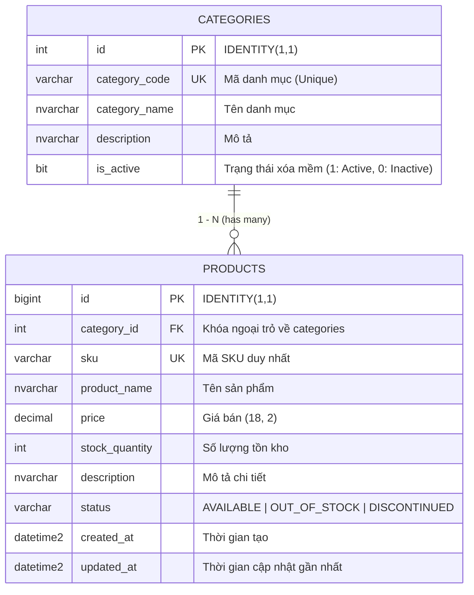
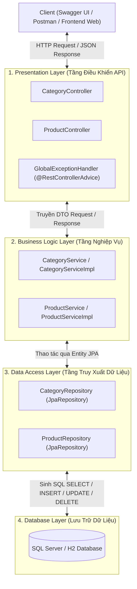

# 🛒 Hướng Dẫn Thực Hành: Xây Dựng RESTful API Quản Lý Danh Mục & Sản Phẩm (Product Catalog API)
## Áp Dụng Database First, DTO Pattern, Jakarta Validation & SpringDoc Swagger UI

> [!abstract] **Mục tiêu chuyên đề**
> Chuyên đề này là bài tập thực chiến trọng tâm của **Giai đoạn 3 (Spring MVC, RESTful API & Spring Data JPA)** trong môn HSF302. 
> Sinh viên sẽ chuyển dịch hoàn toàn từ tư duy làm giao diện hoặc monolithic sang **Backend RESTful API chuẩn doanh nghiệp**:
> 1. Tiếp cận theo hướng **Database First** (Tạo bảng trong SQL Server trước, ánh xạ Entity JPA sau).
> 2. Phân tầng kiến trúc sạch (Clean Architecture): `Controller` $\rightarrow$ `Service` $\rightarrow$ `Repository` $\rightarrow$ `Entity`/`DTO`.
> 3. Tách biệt hoàn toàn `Entity` với `DTO` (Data Transfer Object) để bảo mật và chống over-posting.
> 4. Xử lý lỗi tập trung toàn hệ thống với `@RestControllerAdvice` trả về JSON chuẩn RFC.
> 5. Tự động hóa tài liệu và kiểm thử API trực tiếp qua **Swagger UI** (`/swagger-ui.html`).

---

## 🗄️ 1. Thiết Kế Cơ Sở Dữ Liệu & Sơ Đồ Thực Thể (ERD)

Quan hệ giữa `categories` và `products` là quan hệ **1 - N (One-to-Many / Many-to-One)**:
* Một danh mục (`Category`) chứa nhiều sản phẩm (`Product`).
* Mỗi sản phẩm (`Product`) bắt buộc phải thuộc về một danh mục hợp lệ thông qua khóa ngoại `category_id`.



---

## 🏗️ 2. Mô Hình Kiến Trúc Phân Tầng Chuẩn (Layered Architecture)



---

## 🔍 3. Mổ Xẻ Bản Chất Kỹ Thuật & Các "Bẫy" Cần Lưu Ý Cho Sinh Viên

### 📌 Điểm 1: Database First — Tại sao dùng `spring.jpa.hibernate.ddl-auto=none`?
* Trong môi trường học tập hoặc doanh nghiệp khi DB đã có sẵn (hoặc do DBA quản trị), nếu bạn để `ddl-auto=update` hoặc `create`, Hibernate có thể tự ý sửa đổi kiểu cột, xóa index hoặc tạo sai kiểu dữ liệu `NVARCHAR`/`VARCHAR`.
* Thiết lập `ddl-auto=none` đảm bảo Hibernate **chỉ đọc schema có sẵn**, tuyệt đối không tự ý can thiệp vào cấu trúc bảng của SQL Server.

### 📌 Điểm 2: Tách biệt Entity và DTO (Data Transfer Object)
* **Sai lầm thường gặp của sinh viên:** Trả trực tiếp `@Entity` ra Controller.
  * Hậu quả 1: Dính lỗi vòng lặp vô tận Jackson JSON (`Infinite Recursion`) khi serialize quan hệ 2 chiều giữa `Category` và `Product`.
  * Hậu quả 2: Lộ các trường dữ liệu nhạy cảm hoặc thừa thãi.
* **Giải pháp chuẩn:**
  * `ProductRequest`: Chỉ chứa các trường client được phép gửi lên (kèm annotation `@Valid`).
  * `ProductResponse`: Chứa dữ liệu sạch sẽ, phẳng hóa (flattened) thông tin Category (gồm `categoryId` và `categoryName`) để Client dễ render.

### 📌 Điểm 3: Cơ chế Xóa mềm (Soft Delete) trên Category
* Khi xóa một Category: Không gọi `DELETE FROM categories WHERE id = ?` vì sẽ dính lỗi vi phạm ràng buộc khóa ngoại (Foreign Key Constraint) nếu danh mục đó đã có sản phẩm!
* Thay vào đó, API `DELETE /api/v1/categories/{id}` thực hiện **Soft Delete**:
  ```java
  category.setActive(false);
  categoryRepository.save(category);
  ```
* Các API `GET` sau đó chỉ lấy các danh mục có `is_active = true`:
  ```java
  List<Category> findByIsActiveTrue();
  ```

### 📌 Điểm 4: Nghiệp vụ Tự động cập nhật Trạng thái Tồn kho
* Quy tắc đề bài: Khi thêm mới hoặc cập nhật sản phẩm, nếu `stockQuantity == 0`, hệ thống phải **tự động chuyển trạng thái thành `OUT_OF_STOCK`**.
* Nếu `stockQuantity > 0` và status đang là `OUT_OF_STOCK`, tự động kích hoạt lại `AVAILABLE`. Logic này được đóng gói tập trung tại tầng `Service`.

### 📌 Điểm 5: Phân trang & Lọc linh hoạt (Pagination & Filter)
* Sử dụng `Pageable` của Spring Data:
  ```java
  Pageable pageable = PageRequest.of(page, size, Sort.by("id").descending());
  ```
* Truy vấn lọc nhiều điều kiện (CategoryId tùy chọn + Keyword tùy chọn tìm theo cả Name hoặc SKU) bằng câu JPQL linh hoạt:
  ```sql
  SELECT p FROM Product p WHERE 
  (:categoryId IS NULL OR p.category.id = :categoryId) AND 
  (:keyword IS NULL OR LOWER(p.productName) LIKE LOWER(CONCAT('%', :keyword, '%')) 
                   OR LOWER(p.sku) LIKE LOWER(CONCAT('%', :keyword, '%')))
  ```

### 📌 Điểm 6: Bắt lỗi Validation tập trung (`@RestControllerAdvice`)
* Khi client gửi dữ liệu sai (vd: `price = -100` hoặc `sku = ""`), Spring tự ném ngoại lệ `MethodArgumentNotValidException`.
* Ta không viết khối `try-catch` lặp lại ở từng Controller mà bắt tập trung tại `GlobalExceptionHandler`, trích xuất toàn bộ lỗi của từng trường vào map và trả về HTTP `400 Bad Request` chuẩn format:
  ```json
  {
    "timestamp": "2026-10-08T15:30:00",
    "status": 400,
    "error": "Bad Request",
    "errors": {
      "price": "Giá sản phẩm phải lớn hơn 0",
      "sku": "SKU không được để trống"
    }
  }
  ```

---

## 🧭 4. Danh Sách Endpoint & Barem Kiểm Thử Chi Tiết

### 🔹 Nhóm 1: Danh Mục (`/api/v1/categories`)

| Method | Endpoint | Mô tả | Mã HTTP |
| :---: | :--- | :--- | :---: |
| `GET` | `/api/v1/categories` | Lấy tất cả danh mục đang hoạt động (`is_active = true`) | `200 OK` |
| `GET` | `/api/v1/categories/{id}` | Chi tiết danh mục theo ID | `200` / `404` |
| `POST` | `/api/v1/categories` | Thêm mới (Check trùng `categoryCode`, validate độ dài) | `201` / `400` |
| `PUT` | `/api/v1/categories/{id}` | Cập nhật thông tin danh mục | `200` / `400` / `404` |
| `DELETE` | `/api/v1/categories/{id}` | Xóa mềm danh mục (`is_active = false`) | `204 No Content` / `404` |

### 🔹 Nhóm 2: Sản Phẩm (`/api/v1/products`)

| Method | Endpoint | Query Params / Body | Mô tả | Mã HTTP |
| :---: | :--- | :--- | :--- | :---: |
| `GET` | `/api/v1/products` | `page=0&size=10&categoryId=1&keyword=Pro` | Phân trang + lọc theo danh mục & từ khóa | `200 OK` |
| `GET` | `/api/v1/products/{id}` | Path variable `id` | Xem chi tiết sản phẩm kèm Category | `200` / `404` |
| `POST` | `/api/v1/products` | JSON Body | Thêm mới sản phẩm (Validate số dương, check SKU trùng) | `201` / `400` |
| `PUT` | `/api/v1/products/{id}` | Path variable `id` + JSON | Cập nhật thông tin sản phẩm | `200` / `400` / `404` |
| `DELETE` | `/api/v1/products/{id}` | Path variable `id` | Cập nhật trạng thái `DISCONTINUED` hoặc xóa | `204 No Content` / `404` |

---

## 🚀 5. Thử Nghiệm Nhanh Trên Swagger UI

Sau khi chạy dự án, mở trình duyệt truy cập:
👉 **[http://localhost:8080/swagger-ui.html](http://localhost:8080/swagger-ui.html)**
* Toàn bộ danh sách 10 endpoints sẽ hiển thị trực quan.
* Nhấn nút **"Try it out"** trên Swagger UI để gửi request test trực tiếp mà không cần cài Postman!

---
*Điều hướng nhanh: [[00. Lộ Trình Nghiên Cứu & Giảng Dạy HSF302|Trang Chủ Lộ Trình]] | [[implementation_plan|Kế Hoạch Triển Khai]]*
