# 🎯 Chiến Lược & Cẩm Nang Ôn Thi Practical Exam (PE) — HSF302

> [!important] **Tầm quan trọng của kỳ thi PE**
> - **Tỷ trọng điểm:** 25% tổng kết quả môn học.
> - **Điểm liệt:** Phải đạt tối thiểu **$\ge 4.0$** để được xét qua môn.
> - **Thời lượng làm bài:** 90 - 120 phút trên máy tính phòng thi (thường không có kết nối Internet tự do).

---

## 🧭 Cấu Trúc Đề Thi PE Điển Hình Của Môn HSF

Đề thi thực hành môn HSF thường chia làm 2 dạng chính (tùy theo kỳ):

### 📌 Dạng 1: Xây dựng RESTful API với Spring Boot 3 (Phổ biến nhất)
* **Cho trước:** File script CSDL (SQL Server/MySQL) tạo bảng và chèn sẵn 5-10 dòng dữ liệu mẫu.
* **Yêu cầu thực hiện:**
  1. **Câu 1 (2 điểm) — Khởi tạo & Cấu hình:** Tạo dự án Spring Boot, cấu hình kết nối database trong `application.properties`, tạo Entity khớp với cấu trúc bảng (chú ý khóa chính `@Id`, `@GeneratedValue`, mapping kiểu dữ liệu).
  2. **Câu 2 (2 điểm) — Tầng Repository:** Tạo interface kế thừa `JpaRepository`, viết thêm method truy vấn theo điều kiện (vd: tìm kiếm theo tên hoặc khoảng giá).
  3. **Câu 3 (3 điểm) — Tầng Service & Nghiệp vụ:** Viết các hàm nghiệp vụ (Lấy danh sách, Lấy theo ID, Thêm mới có kiểm tra logic trùng lặp, Cập nhật, Xóa).
  4. **Câu 4 (3 điểm) — REST Controller:** Viết các endpoints:
     - `GET /api/v1/items`: Lấy danh sách (hỗ trợ filter/search).
     - `GET /api/v1/items/{id}`: Lấy chi tiết (trả về 404 nếu không tìm thấy).
     - `POST /api/v1/items`: Thêm mới (Validation dữ liệu, trả về 201 Created).
     - `PUT /api/v1/items/{id}`: Cập nhật (trả về 200 OK).
     - `DELETE /api/v1/items/{id}`: Xóa bản ghi (trả về 204 No Content hoặc 200 OK).

### 📌 Dạng 2: Ứng dụng Desktop JavaFX kết nối Database qua JPA
* Tạo giao diện quản lý bằng FXML (TableView + Form nhập liệu + Các nút chức năng Thêm/Sửa/Xóa/Reset).
* Khi mở app: Tự động load dữ liệu từ Database lên TableView.
* Click vào 1 dòng trên Table: Tự động đổ dữ liệu lên các ô TextField tương ứng.
* Nút Thêm/Sửa/Xóa: Thực hiện tương tác với Entity qua EntityManager/Repository và cập nhật lại TableView.

---

## ⚡ Bảng Phân Bổ Thời Gian 90 Phút Chuẩn Phòng Thi

```mermaid
gantt
    title Phân Bổ Thời Gian Làm Bài PE 90 Phút
    dateFormat mm
    axisFormat %M m
    section Các Bước
    Đọc kỹ đề & Chạy Script Database       :00, 10m
    Tạo Project & Cấu hình application.prop:10, 10m
    Tạo Entity & Repository                :20, 15m
    Triển khai Service & Logic nghiệp vụ   :35, 25m
    Triển khai Controller & Test Postman/Swagger :60, 20m
    Kiểm tra lại toàn bộ & Đóng gói nộp bài:80, 10m
```

---

## ⚠️ Các "Bẫy" Thường Gặp Khi Thi PE Khiến Sinh Viên Mất Điểm

1. **Sai kiểu dữ liệu Entity:** Cột trong DB là `NVARCHAR` hoặc `DATETIME` nhưng trong Entity đặt sai kiểu, hoặc quên `@Column(name = "...")` khi tên cột DB khác tên thuộc tính Java.
2. **Quên `@RequestBody` hoặc `@PathVariable`:** Dẫn đến Controller không nhận được dữ liệu JSON hoặc ID từ URL (luôn bị `null`).
3. **Lỗi quan hệ tuần hoàn (Infinite Loop JSON):** Khi mapping `@OneToMany` và `@ManyToOne`, Jackson serialize dữ liệu bị loop vô tận gây tràn bộ nhớ $\rightarrow$ Giải pháp: Dùng DTO hoặc `@JsonIgnore` / `@JsonBackReference`.
4. **Không nộp file cấu hình hoặc sót file khi nộp bài:** Quên kiểm tra chạy thử lệnh `mvn clean package` trước khi nén thư mục nộp bài.

---
*Điều hướng: [[00. Lộ Trình Nghiên Cứu & Giảng Dạy HSF302|Về Trang Chủ Lộ Trình]] | [[implementation_plan|Kế Hoạch Triển Khai]]*
