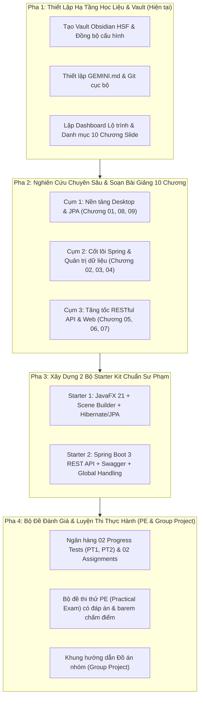

# 📋 Kế Hoạch Triển Khai (Implementation Plan) — Nghiên Cứu & Đóng Gói Giáo Trình HSF302

> [!abstract] **Mục tiêu dự án**
> Đồng hành cùng Giảng viên nghiên cứu sâu bản chất kỹ thuật của **Spring Boot 3** và **JPA/Hibernate (mã môn HSF302)**, từ đó thiết kế lộ trình giảng dạy, tài liệu tóm lược trực quan, bộ Starter Kits thực chiến và ngân hàng đề thi Practical Exam (PE) giúp sinh viên nắm vững bản chất, xóa bỏ tâm lý "học vẹt annotation".

---

## 🧭 Cấu Trúc Tổng Thể Các Hạng Mục Cần Làm

---

## 📝 Danh Sách Đầu Việc Chi Tiết (Actionable Checklist)

### 📌 Pha 1: Khởi Tạo Môi Trường & Bộ Quy Chuẩn (Vault Setup)
- [x] Tạo mới Vault Obsidian `D:\Obsidian_Save\HSF` với đầy đủ cấu hình core plugins.
- [x] Thiết lập `GEMINI.md` làm bộ quy chuẩn vận hành và `git init` cục bộ để rollback an toàn.
- [x] Tạo file master `00. Lộ Trình Nghiên Cứu & Giảng Dạy HSF302.md` tổng hợp 10 chương từ bộ slide gốc `D:\Obsidian_Save\Just_Something4Anti\Slides`.
- [x] Soạn chuyên đề đối chiếu bản chất kỹ thuật: [[Giai Thich Ban Chat Spring Boot Tu Goc Nhin .NET|Giải Thích Bản Chất Spring Boot Từ Góc Nhìn .NET & Java MVC]] ✅
- [x] Cập nhật tiến độ vào Vault `Todo_List` (`00. Tổng quan - Dashboard.md` & `02. Việc hôm nay (Today).md`).

### 📚 Pha 2: Soạn Thảo Học Liệu 10 Chương (Bản Chất & Sư Phạm Trực Quan)
- [x] **Phân tích toàn diện Bài tập thực hành mẫu 3 Cấp độ:** [[Giai Thich Chi Tiet Bai Tap Mau JPA (User-Profile-Order)|Mổ Xẻ Chi Tiết Bài Tập Thực Hành JPA (User - Profile - Order) từ Cấp 1 đến Cấp 3]] ✅
- [ ] **Chương 00 & Môi trường:** Setup JDK 21, IntelliJ IDEA, Maven, Scene Builder 23.
- [/] **Chương 01: JPA & ORM Mapping:**
  - [x] Giải thích bản chất ORM (Object-Relational Mapping): Tại sao không viết SQL thuần bằng JDBC? ✅
  - [x] Entity Lifecycle (Transient, Managed, Detached, Removed) & Dirty Checking. ✅
  - [x] Annotations cốt lõi: `@Entity`, `@Table`, `@Id`, `@GeneratedValue`, `@Column`. ✅
  - [x] Mối quan hệ bảng: `@OneToOne`, `@OneToMany`, `@ManyToOne`, `@JoinColumn`, vấn đề Lazy Loading (`FetchType.LAZY`) & `JOIN FETCH`. ✅
- [ ] **Chương 08: Introduction to JavaFX:**
  - Cấu trúc Stage - Scene - Scene Graph.
  - Sử dụng Scene Builder để kéo thả giao diện, sinh file FXML.
  - Binding dữ liệu từ UI vào Controller (`@FXML`).
- [ ] **Chương 09: Build CRUD with JavaFX & JPA:**
  - Tích hợp EntityManager vào ứng dụng JavaFX Desktop.
  - Xây dựng chức năng CRUD Sinh viên hoàn chỉnh trên TableView.
- [ ] **Chương 02: Spring Framework Core (IoC & DI):**
  - Vấn đề ghép nối chặt (Tight Coupling) trong Java truyền thống.
  - Inversion of Control (IoC) Container & Dependency Injection (DI) hoạt động như thế nào?
  - Cơ chế quét Component Scan: `@Component`, `@Service`, `@Repository`, `@Autowired` (Field vs Constructor Injection).
- [ ] **Chương 03: Spring Boot Concepts & Starters:**
  - Tại sao cần Spring Boot? (Không còn file `web.xml`, không cần setup Tomcat rời).
  - `spring-boot-starter-*` và cơ chế Auto-Configuration (`@EnableAutoConfiguration`).
  - Cấu hình ứng dụng qua `application.properties` / `application.yml`.
- [ ] **Chương 04: Spring Data JPA:**
  - So sánh JPA thuần (EntityManager/EntityTransaction) với `JpaRepository`.
  - Cơ chế sinh truy vấn tự động theo tên phương thức (`findBy...`, `countBy...`).
  - Viết truy vấn tùy biến với `@Query` (JPQL vs Native SQL).
- [ ] **Chương 05: Spring MVC Architecture:**
  - Luồng đi của 1 request: `DispatcherServlet` $\rightarrow$ `HandlerMapping` $\rightarrow$ `Controller` $\rightarrow$ `ViewResolver`.
- [ ] **Chương 06: Spring Web & RESTful API:**
  - Phân biệt Web truyền thống (HTML SSR) và REST API (JSON).
  - Các phương thức HTTP (GET, POST, PUT, DELETE, PATCH) và mã phản hồi HTTP (200, 201, 400, 404, 500).
  - `@RestController`, `@RequestBody`, `@PathVariable`, `@RequestParam`, `ResponseEntity<T>`.
  - DTO Pattern & Validation với `jakarta.validation` (`@Valid`, `@NotBlank`, `@Min`, `@Max`).
  - Xử lý lỗi tập trung toàn hệ thống với `@RestControllerAdvice` và `@ExceptionHandler`.
- [ ] **Chương 07: Data Access & Thymeleaf App:**
  - Tích hợp Thymeleaf hiển thị dữ liệu động (dành cho phần thi kết thúc môn và đồ án).

### 🛠️ Pha 3: Xây Dựng 2 Bộ Starter Kit Thực Chiến
- [ ] **Starter Kit 1 — JavaFX Desktop + JPA CRUD:**
  - Cấu trúc Maven chuẩn, chạy độc lập không phụ thuộc plugin rườm rà.
  - Database H2 in-memory / MySQL script có sẵn dữ liệu mẫu.
  - Code mẫu `StudentManagementApp` trực quan, dễ hiểu.
- [x] **Starter Kit 2 — Spring Boot 3 RESTful API (Product Catalog API):** ✅
  - [x] Soạn hướng dẫn chi tiết: [[Huong Dan Xay Dung RESTful API Product Catalog|Xây Dựng RESTful API Quản Lý Danh Mục & Sản Phẩm (Product Catalog API)]] ✅
  - [x] Khung mã nguồn hoàn chỉnh `product-catalog-api`: Controller $\rightarrow$ Service $\rightarrow$ Repository $\rightarrow$ Entity/DTO (`E:\Mindy\HSF\Code_Demo\product-catalog-api`). ✅
  - [x] Tích hợp OpenAPI Swagger UI (`/swagger-ui.html`), validation và `@RestControllerAdvice`. ✅

### 🎯 Pha 4: Ngân Hàng Đề Thi & Hướng Dẫn Ôn Luyện Practical Exam (PE)
- [ ] **Chiến lược thi PE (Practical Exam - Chiếm 25% điểm):**
  - Mẫu đề thi PE HSF302 FPT: Tạo Entity kết nối Database cho sẵn, viết Repository, triển khai Service và viết API Controller theo yêu cầu.
  - Bảng "Cheat Sheet" các bước làm bài PE từ phút 0 đến phút 90 để không bị bỡ ngỡ.
  - Bộ 02 đề thi thử PE Mock kèm barem điểm và Solution source code.
- [ ] **Hướng dẫn Đồ án nhóm (Group Project - Chiếm 25% điểm):**
  - Danh mục 5 chủ đề dự án mẫu (E-Commerce, Movie Ticket Booking, Hotel Management...).
  - Checklist tiêu chí chấm điểm và hướng dẫn viết tài liệu kiến trúc.

---

## 🔄 Trạng Thái Đang Xử Lý & Tiến Trình Kế Tiếp
- **Hiện tại:** Đang hoàn tất Pha 1 và tạo bộ khung tài liệu tổng quan.
- **Tiếp theo:** Cùng Giảng viên thảo luận lựa chọn nội dung ưu tiên (Bắt đầu từ Cụm JPA/JavaFX hay chuyển thẳng vào Cốt lõi Spring Boot REST API).
